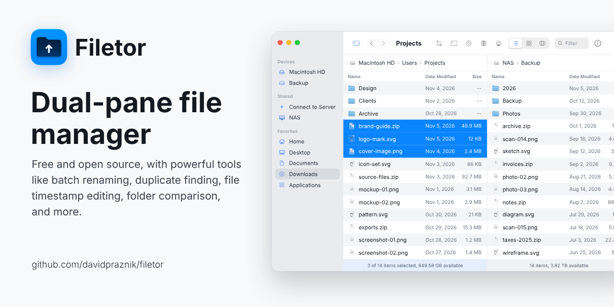
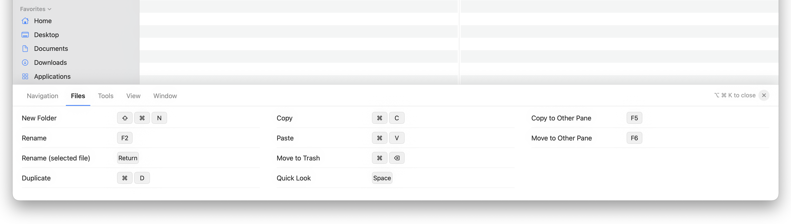
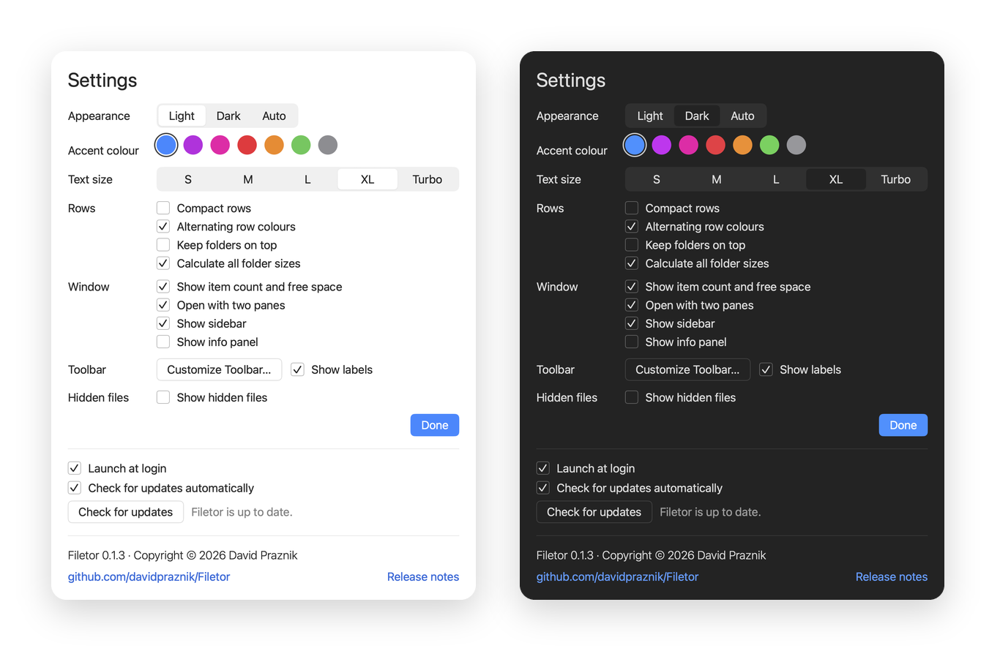

  

# Filetor

Filetor is a free, open source dual-pane file manager for macOS, written in Swift and SwiftUI. Two folders side by side, one toolbar you can shape yourself, and a set of tools that macOS Finder does not have.

I made it for my own work, where I move and compare files between folders, disks and network drives all day.

## Features

**Browsing**
- Two panes side by side, with tabs in each pane. Swap the panes or switch to a single pane.
- List, icon and column views, a filter field and an info panel with details and a preview.
- Sidebar with favorites, mounted disks (with eject), cloud storage (iCloud Drive, Google Drive, Dropbox, OneDrive) and network servers.
- Quick Look on the space bar.

**Moving files**
- Drag and drop between the panes, the sidebar and the Drop Stack. Copy by default, hold Command to move.
- Copy to Other Pane, Move to Other Pane, Copy to… and Move to… with a progress indicator and conflict handling.
- Network servers (SMB and AFP) appear under Shared automatically. Connect to Server opens any address.

**Tools Finder does not have**
- Batch rename with a live preview: replace text, add text, numbering.
- Find Duplicates in a folder, by size and then by checksum. Review the results and move the extra copies to the Trash.
- Compare Folders: shows what is missing or different between the two panes, by name, size and date.
- Touch: sets the modification date of the selected files to now.
- Folder sizes: an option shows the size of every folder in the list, like Finder does (Settings > Rows).
- Compress and Decompress, Copy Path, Reveal in Finder, Open in Terminal.
- Rotate Left, Rotate Right and Convert Image (PNG, JPEG, HEIC, TIFF) for image files.
- Get Info opens the Finder info window for the selected items (⌘I).
- Open With, Share (AirDrop, Mail, Messages) and the macOS Services menu, from the Commands menu and the context menu.
- Show or hide hidden files with one click.

**Actions and shortcuts**
- ⌘K opens Actions: type a few letters and run any action.
- ⌥⌘K shows all keyboard shortcuts in tabs at the bottom of the window.
- ⌘F moves focus to the search field in the toolbar.

  

**Customizable toolbar**
- Choose which tools are in the toolbar: click an item to add or remove it, or drag it in or out.
- Drag items inside the toolbar to change their order. Show labels adds a name under each icon.
- Restore Defaults brings back the original set.
- Open it from Settings or from the Filetor menu: Customize Toolbar…

## Settings

  

- Appearance: Light, Dark or Auto.
- Accent colour: seven colours, applied across the app.
- Text size: from S to Turbo.
- Rows: compact rows, alternating row colours, keep folders on top, calculate all folder sizes.
- Window: show item count and free space, open with two panes, show sidebar, show info panel.
- Launch at login and automatic update check.

## Requirements

- macOS 14 or newer.

## Download

Download the latest `Filetor.zip` from [Releases](https://github.com/davidpraznik/Filetor/releases), unzip it and move Filetor to Applications.

### Opening a downloaded build

The builds are not signed with a paid Apple Developer account and are not notarized, so macOS will block the first launch.

1. Open Filetor once. macOS shows a message that it cannot be opened.
2. Open System Settings > Privacy & Security and scroll down to the Security section.
3. Click Open Anyway next to Filetor and confirm.

You only need to do this once.

## Build from source

1. Clone the repository.
2. Open `Filetor.xcodeproj` in Xcode.
3. Select the Filetor scheme and press Run (⌘R).

## Safety

Filetor works on real files: it copies, moves, renames and trashes them. It is early software. Try it on a test folder first and keep backups of anything important.

## About

I am David Praznik, a UX/UI and product designer. Filetor started as a tool for my own needs and I am sharing it as it is. It is open source under the MIT licence. If you find a bug or miss something, open an [issue](https://github.com/davidpraznik/Filetor/issues).

## Licence

MIT, see [LICENSE](LICENSE).

Copyright © 2026 David Praznik
