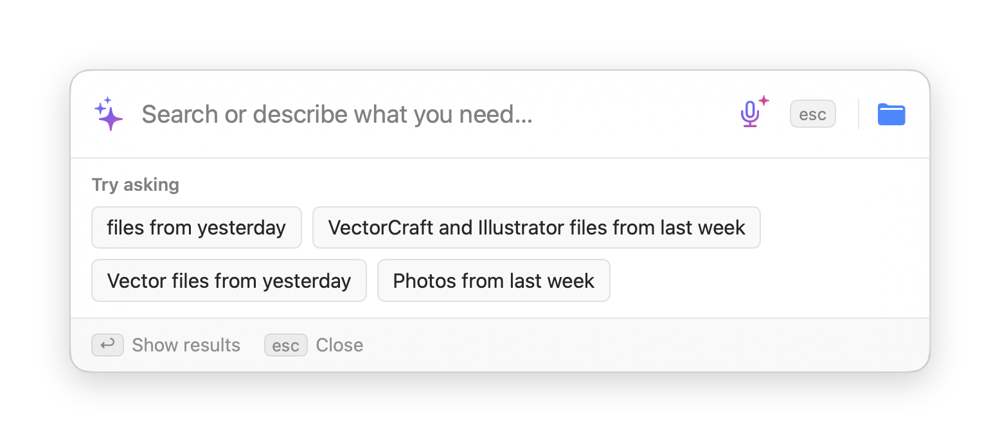
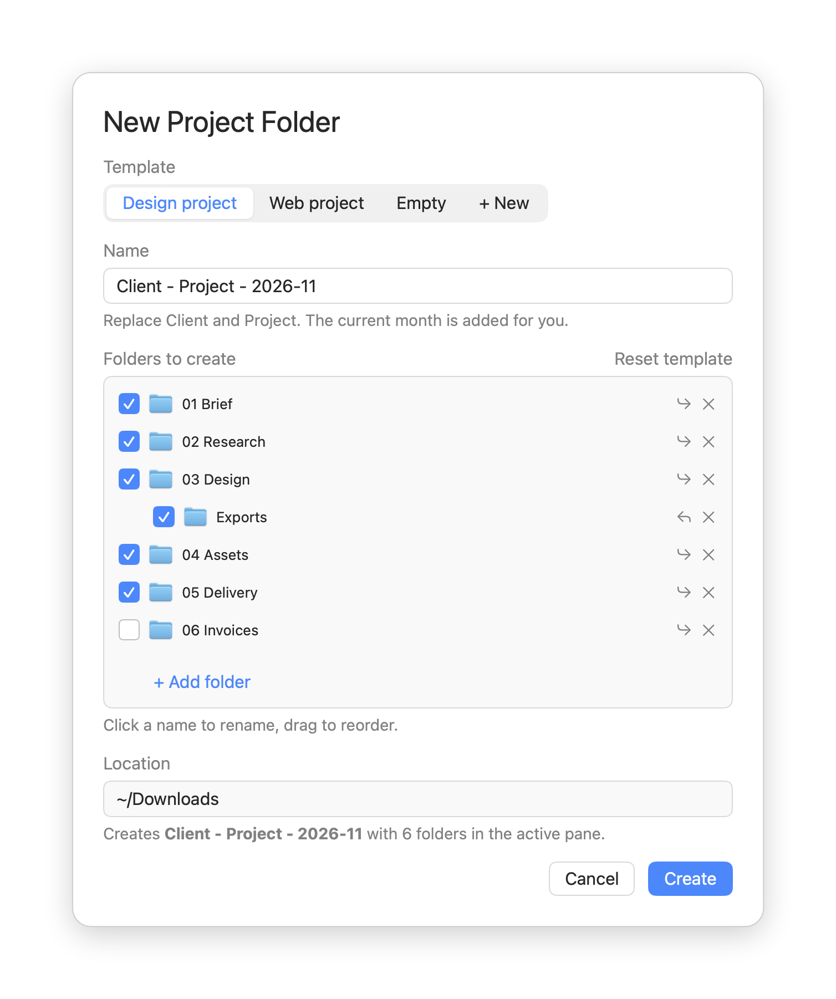
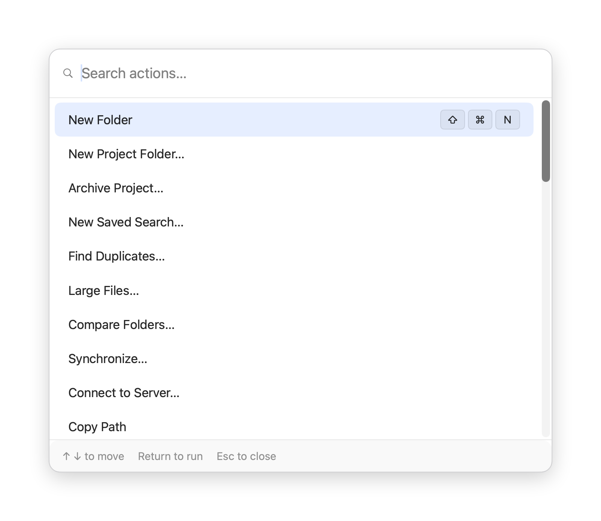
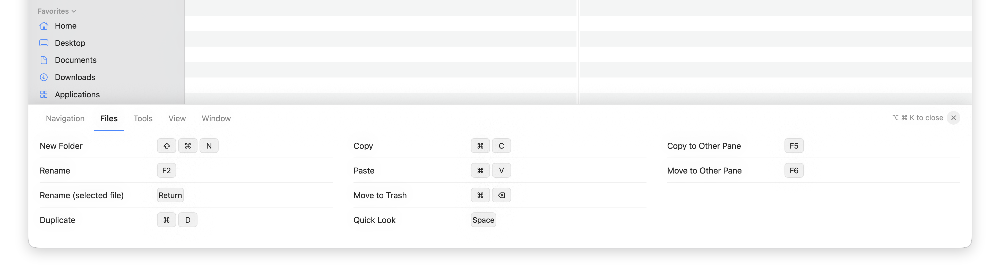
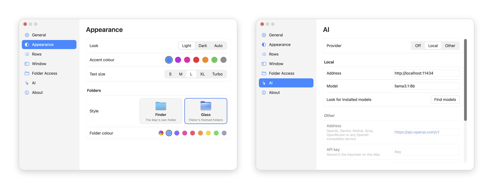

  

# Filetor

Filetor is a free, open source dual-pane file manager for macOS, written in Swift and SwiftUI. Two folders side by side, one toolbar you can shape yourself, and a set of tools that macOS Finder does not have.

I made it for my own work, where I move and compare files between folders, disks and network drives all day.

Filetor also includes the functions of my two other apps, [Konverter](https://github.com/davidpraznik/Konverter) (convert, optimize and clean images) and [Archivator](https://github.com/davidpraznik/Archivator) (compress and extract archives), so that the file work I do as a UX/UI designer happens in one app. Konverter and Archivator remain separate apps.

## Search with a sentence

Type what you need in the search field, for example "VectorCraft and Illustrator files from last week" or "photos from last week". Filetor turns the sentence into filters for name, kind, date and size. The searches you repeat most often appear under Try asking. The microphone button listens to your voice, writes the words into the field and stops by itself after a pause. It uses Apple speech recognition in the language of your Mac. AI search is optional and off by default.

  

## Features

**Browsing**
- Two panes side by side, with tabs in each pane. Swap the panes or switch to a single pane.
- List, icon and column views, a filter field and an info panel with details and a preview.
- Search in subfolders: turn it on next to the filter field and the list shows matches from all subfolders, with a Folder column and a Stop button.
- Folders open in place as a tree in the list view, with a disclosure arrow.
- Columns of the list view (order and width) stay the same in both panes.
- Open folders and tabs of both panes are restored when you start the app.
- Sidebar with Favorites, Locations (cloud storage such as iCloud Drive, Google Drive, Dropbox and OneDrive, disks with eject, and Network), Searches and Tags. Drag the sections, and the rows inside Locations, into your own order. Each part can be shown or hidden in Settings > Window, or with a right-click in the sidebar.
- Right-click a folder in the path bar for the same actions as in the list.
- Quick Look on the space bar. On a folder or an archive, the space bar shows what is inside it.
- Themed folder icons (optional): Finder or Glass folders, with symbols for common folders such as Documents, Downloads, Pictures, Designs, Code, Public and Applications. Choose a multicolour or a single folder colour (Settings > Appearance).

**Moving files**
- Drag and drop between the panes, the sidebar and the Drop Stack. Copy by default, hold Command to move.
- Copy to Other Pane, Move to Other Pane, Copy to… and Move to… with a progress indicator and conflict handling.
- Undo and redo (⌘Z, ⇧⌘Z) for rename, move to Trash, new file or folder, copy and move.
- Rename in the row, like in Finder.
- Network in Locations lists the file servers found on your local network. Double-click a server to connect; macOS asks for the login.
- Go to Folder (⇧⌘G) is one popup for a path and for a server address (smb://, afp://, nfs://, https://). It lists recent folders and servers, and the examples in it can be clicked to start typing.

**Tools Finder does not have**
- Batch rename with a live preview: replace text, add text, numbering.
- Find Duplicates in a folder, by size and then by checksum. Review the results and move the extra copies to the Trash.
- Compare Folders: shows what is missing or different between the two panes, by name, size and date.
- Synchronize: copies the differences between the two panes one way or both ways. You can change the direction of every file, newer files replace older ones, replaced files go to the Trash and nothing is deleted.
- Touch: sets the modification date of the selected files to now.
- Large Files: lists the biggest files in a folder, largest first.
- Folder sizes: an option shows the size of every folder in the list, like Finder does (Settings > Rows).
- Compress and Decompress, Copy Path, Reveal in Finder, Open in Terminal.
- Rotate Left, Rotate Right and Convert Image (PNG, JPEG, HEIC, TIFF, WebP) for image files.
- Optimize for images: sets the longest side (never enlarges), quality, sRGB conversion and metadata removal. Saves `name-web` next to the original, or replaces the original (it goes to the Trash, undo works). PNG can be reduced to 256 colors. Works with JPEG, PNG, HEIC and WebP.
- Strip Metadata removes EXIF, location and other metadata from images and saves `name-clean` next to the original.
- Delete Immediately (⌥⌘⌫) for files that cannot go to the Trash, for example on network disks. It asks for confirmation first.
- Get Info opens the Finder info window for the selected items (⌘I).
- Open With, Share (AirDrop, Mail, Messages) and the macOS Services menu, from the Commands menu and the context menu.
- Show or hide hidden files with one click.

**AI search (optional, off by default)**
- Type a sentence in the search field, for example "PDFs larger than 5 MB" or "images from last month". Filetor turns it into filters (name, kind, date, size), shows them as chips and searches the current folder and its subfolders.
- It works with a local model through [Ollama](https://ollama.com) or with any OpenAI-compatible service (OpenAI, Gemini, Mistral, Groq, OpenRouter and others), set up in Settings > AI.
- Only the sentence you type and today's date are sent. File names and file contents are never sent. With a local model nothing leaves your Mac.
- The API key for a service is stored in the macOS Keychain.

**Sort Downloads (optional, off by default)**
- Sorts the files in a folder into subfolders, the ones already there and the ones that arrive later: Images, Documents, Archives, Installers, Video, Audio, 3D Models, Fonts, Design and Scripts.
- Works on Downloads and on any other folders you add, also on an external disk. A folder on a disk that is not connected waits until the disk is back.
- Your own rules are checked first: match an extension or a part of the file name and choose the folder. Settings > Sorting.
- Files that are still being downloaded are left alone, an existing file is never overwritten, and every move shows a notice with Undo.

**Projects, tags and searches**
- New Project Folder creates a project folder with a set of subfolders from a template (Design project, Web project, Empty). You can turn subfolders on or off, rename them and save your own templates.
- Archive Project zips a folder, checks the zip and can move the original folder to the Trash. The archive is saved next to the folder by default, or in a folder you choose, and has a date in its name.
- Finder tags: add, change and remove tags from the context menu, including new tags. Tags are the same as in Finder. The list view has a Tags column, and the sidebar has a Tags section where a click shows all items with that tag.
- Tag search also works on network disks and cloud storage, which Spotlight does not index. Filetor scans the current folder and its subfolders instead.
- Saved searches: search by name, kind (images, design files, PDF, documents, video, folders), extensions, modified date and tag, in a folder you choose. A saved search appears in the sidebar under Searches.

  

**Actions**
- ⌘K opens Actions, one list of everything Filetor can do. Type a few letters and press Return to run an action.
- It covers file operations (rename, duplicate, copy and move, Move to Trash), compress and decompress, image tools (rotate, convert to PNG, JPEG, HEIC, WebP or TIFF, optimize, strip metadata), New Project Folder, Archive Project, Find Duplicates, Large Files, Compare Folders, Synchronize, Connect to Server, tabs, panes and Settings.
- Actions that do not apply to the current selection are dimmed, for example image tools when no image is selected.
- If an action has a keyboard shortcut, it is shown next to it.

  

**Keyboard shortcuts**
- ⌥⌘K shows all keyboard shortcuts in tabs at the bottom of the window.
- ⌘F opens a search popup in the style of Actions. Typing filters the current folder, and a sentence is read by the AI when AI search is on.

  

**Customizable toolbar**
- Choose which tools are in the toolbar: click an item to add or remove it, or drag it in or out.
- Drag items inside the toolbar to change their order. Show labels adds a name under each icon.
- Restore Defaults brings back the original set.
- Open it from Settings or from the Filetor menu: Customize Toolbar…

## Settings

  

- General: launch at login, open with two panes, show hidden files, search the local network for servers, automatic update check.
- Appearance: Light, Dark or Auto. Accent colour (seven colours). Text size from S to Turbo. Folders: Finder or Glass, and a multicolour or single folder colour.
- Rows: row size (one slider for the icon and the row), alternating row colours, keep folders on top, calculate all folder sizes, file extensions, icon previews.
- Window: status bar with item count and free space, sidebar, info panel, which sidebar sections are shown, toolbar items and labels.
- Sorting: turn Downloads sorting on, choose the folders and set your own rules.
- Folder Access: shows whether Full Disk Access is on and opens the page in System Settings where you turn it on.
- AI: provider (Off, Local or Other), address, key and model, and a connection test.
- About: version and links.

## Requirements

- macOS 14 or newer.

## Download

Download the latest `Filetor.zip` from [Releases](https://github.com/davidpraznik/Filetor/releases), unzip it and move Filetor to Applications.

### Opening a downloaded build

The builds are not signed with a paid Apple Developer account and are not notarized, so macOS will block the first launch.

1. Open Filetor once. macOS shows a message that it cannot be opened.
2. Open System Settings > Privacy & Security and scroll down to the Security section.
3. Click Open Anyway next to Filetor and confirm.

You only need to do this once.

### Full Disk Access (optional)

Without it, macOS asks for permission for each protected folder separately. To stop the prompts, open System Settings > Privacy & Security > Full Disk Access, drag Filetor.app into the list and restart Filetor. Settings > Folder access shows whether it is on.

The builds are not signed with a paid Apple Developer account, so macOS drops this permission after an update. Remove Filetor from the list and drag it in again.

## Build from source

1. Clone the repository.
2. Open `Filetor.xcodeproj` in Xcode.
3. Select the Filetor scheme and press Run (⌘R).

## Privacy

Filetor does not collect any telemetry, analytics or usage data. The only request the app makes to the internet by itself is the update check, which asks GitHub for the latest release number. You can turn it off in Settings. On your local network, Filetor looks for file servers (Bonjour, and a check of port 445 on the addresses of your own subnet) so they can be listed under Network. This search only connects to devices in your home or office network and sends nothing to anyone. macOS asks for permission for it the first time. You can turn it off in Settings > General. AI search is off by default. If you turn it on, only the sentence you type and today's date are sent, to the service you choose, or to a model on your own Mac. Everything else (files, tags, searches, settings) stays on your Mac.

## Safety

Filetor works on real files: it copies, moves, renames and trashes them. Keep backups of anything important, and try a new tool on a test folder first.

## About

I am David Praznik, a UX/UI and product designer. Filetor started as a tool for my own needs and I am sharing it as it is. It is open source under the MIT licence. If you find a bug or miss something, open an [issue](https://github.com/davidpraznik/Filetor/issues).

## My other apps

Filetor includes the functions of these two apps. They remain available as separate apps:
- [Konverter](https://github.com/davidpraznik/Konverter): convert, optimize and clean images (Convert Image, Optimize, Strip Metadata, WebP).
- [Archivator](https://github.com/davidpraznik/Archivator): compress and extract archives (ZIP, 7z, tar.gz and more).

Another app of mine, not part of Filetor:
- [Memory Pressure](https://github.com/davidpraznik/MemoryPressure): a menu bar app that shows CPU and RAM use and can clear memory.

## Third-party software

- [libwebp](https://chromium.googlesource.com/webm/libwebp) (BSD 3-Clause), WebP encoding.

## Licence

MIT, see [LICENSE](LICENSE).

Copyright © 2026 David Praznik
